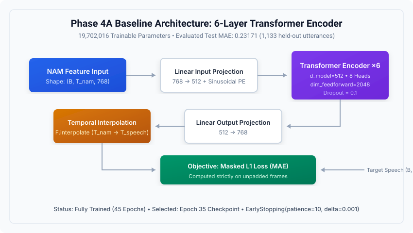
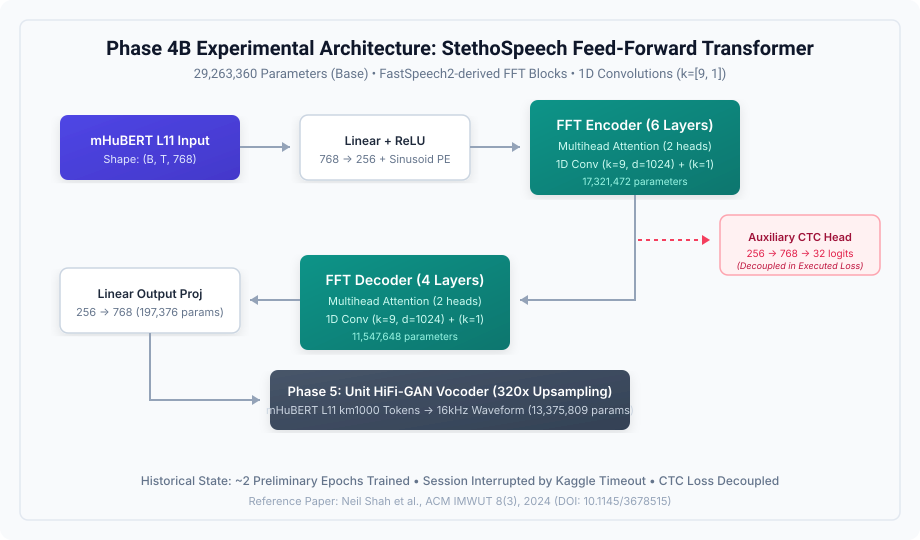

# StethoSpeech: Non-Audible Murmur to Audible Speech Translation

An independent reproduction, engineering study, and domain adaptation of the StethoSpeech acoustic translation pipeline, mapping stethoscopic skin vibrations into audible speech representations using self-supervised speech representations and neural vocoding.



---

## 1. Project Overview

Non-Audible Murmur (NAM) speech represents acoustic vibration signals captured by an electronic stethoscope attached directly to the body. Following the original StethoSpeech experimental setup (Shah et al., ACM IMWUT 2024), the primary sensor is a **3M Littmann 3200 Electronic Stethoscope** positioned over the **retroauricular mastoid bone** (behind the ear) and held firmly in place with an elastic headband. Additional contact points include the **submental** (under-chin) and **anterolateral neck** skin surfaces. These placements capture bone-conducted and soft-tissue acoustic vibrations generated during unvoiced murmuring while effectively isolating the recording from ambient airborne noise.

This repository provides an open research codebase evaluating sequence-to-sequence neural translation from NAM signals to audible speech features in self-supervised latent spaces (HuBERT / mHuBERT), coupled with discrete unit neural vocoding (Unit HiFi-GAN).

### Key Implementations
- **Phase 4A Baseline:** A 19.7M-parameter 6-layer Transformer mapping HuBERT representations with dynamic temporal interpolation.
- **Phase 4B Experimental Architecture:** A 29.26M-parameter Feed-Forward Transformer (FFT) architecture incorporating 1D depth convolutions (kernel 9) adapted from the published StethoSpeech specification.
- **Phase 5 Pure-PyTorch Vocoder:** A native PyTorch reimplementation of Meta AI's Unit HiFi-GAN generator ($320\times$ temporal upsampling) eliminating external C++ compilation dependencies.
- **Data Engineering:** Automated Montreal Forced Aligner (MFA) corpus restructuring, flexible partitioning supporting arbitrary validation/test ratios (including zero-test Phase 4B settings), and validation safeguards.
- **Robust Inference & Training CLI:** End-to-end command-line interfaces for training, checkpoint evaluation, and discrete-unit/feature vocoder synthesis with strict checkpoint validation (preventing silent fallback to random weights).

---

## 2. Research Problem

Conventional silent speech interfaces (SSI) often rely on invasive electromyography (EMG) or ultrasound imaging. Stethoscopic NAM sensing offers a non-invasive, passive alternative suitable for:
- Assistive communication for individuals with vocal tract impairments (e.g., laryngectomy patients).
- Secure, silent communication in high-noise or covert environments.
- Hands-free, low-acoustic-radiation speech interfaces.

Because NAM audio and microphone speech live in fundamentally different spectral distributions, direct acoustic spectrogram regression often results in severe over-smoothing. Translating in the latent feature space of self-supervised speech representations (HuBERT) provides discrete or continuous representations that decouple phonetic content from speaker acoustics.

---

## 3. Reference Publication & Attribution

This work is an independent academic reproduction and extension of the research introduced by:

> **Neil Shah, Neha Sahipjohn, Vishal Tambrahalli, Ramanathan Subramanian, and Vineet Gandhi.**  
> *"StethoSpeech: Speech Generation Through a Clinical Stethoscope Attached to the Skin."*  
> **Proceedings of the ACM on Interactive, Mobile, Wearable and Ubiquitous Technologies (IMWUT)**, Volume 8, Issue 3, Article 123 (September 2024), 21 pages.  
> DOI: [10.1145/3678515](https://doi.org/10.1145/3678515)

*Attribution Notice:* The author of this repository was not an author or co-author of the original StethoSpeech publication. This repository represents an independent engineering reproduction, academic report (May 2026), and subsequent modular research release.

---

## 4. Architecture Overview

### 4.1 Phase 4A Transformer Baseline (19.7M Parameters)
- **Input Dimension:** 768-dim HuBERT Base (Layer 12)
- **Encoder:** 6 Transformer layers, $d_{\text{model}} = 512$, $n_{\text{head}} = 8$, $d_{\text{ff}} = 2048$, dropout = 0.1
- **Output Dimension:** 768-dim predicted speech representations
- **Loss:** Masked L1 loss with linear time interpolation (`F.interpolate`) to align slight temporal length mismatches between sensor channels.
- **Total Parameters:** **19,702,016**

### 4.2 Phase 4B StethoSpeech FFT Architecture (29.26M Parameters)


- **Input Dimension:** 768-dim mHuBERT Base (Layer 11)
- **Encoder:** 6 FFT blocks ($d_{\text{model}} = 256$, $n_{\text{head}} = 2$, $d_{\text{inner}} = 1024$, 1D Conv kernels $[9, 1]$)
- **Decoder:** 4 FFT blocks ($d_{\text{model}} = 256$, $n_{\text{head}} = 2$, $d_{\text{inner}} = 1024$, 1D Conv kernels $[9, 1]$)
- **Auxiliary Head:** Linear CTC classification head (256 $\to$ 768 $\to$ 32 vocab). *Note: The CTC head is defined in the network AST for structural fidelity to the paper, but was decoupled from the executed loss during training.*
- **Total Parameters:** **29,263,360** (executed base model) / **29,485,344** (with auxiliary CTC projection head).

### 4.3 Phase 5 Unit HiFi-GAN Vocoder (13.38M Parameters)
- **Input:** Discrete acoustic tokens (0–999) from K-Means clustering ($K=1000$).
- **Upsampling Stages:** Rates $[5, 4, 4, 2, 2]$ yielding a total temporal upsampling factor of $320\times$ (converting 50 Hz frame tokens into 16,000 Hz continuous audio waveforms).
- **Multi-Receptive Field (MRF):** Parallel residual blocks across kernel sizes $[3, 7, 11]$ and dilations $[1, 3, 5]$.
- **Total Parameters:** **13,375,809**

---

## 5. Repository Structure

```text
stethospeech/
├── .github/
│   └── workflows/ci.yml           # GitHub Actions CI pipeline (CPU tests, Python 3.10-3.13)
├── assets/
│   └── figures/                  # Clean vector architecture schematics (SVG)
├── configs/
│   ├── baseline_transformer.yaml # Phase 4A Transformer baseline configuration
│   ├── experimental_fft.yaml     # Phase 4B StethoSpeech FFT configuration
│   └── vocoder.yaml              # Phase 5 Unit HiFi-GAN vocoder configuration
├── docs/
│   ├── architecture.md           # Mathematical formulations and parameter derivations
│   ├── provenance.md             # Forensic chain of custody and source classification
│   └── reproducibility.md        # Detailed reproduction matrix and boundaries
├── scripts/
│   ├── download_models.py        # Fetches public Meta AI CDN checkpoints
│   ├── prepare_corpus.py         # Automates MFA corpus reorganization
│   ├── train.py                  # CLI training entry point
│   └── synthesize.py             # CLI inference and vocoding entry point
├── src/
│   └── stethospeech/
│       ├── data/                 # Datasets, collate functions, and MFA corpus structuring
│       ├── features/             # HuBERT extraction and K-Means quantizer
│       ├── models/               # Transformer baseline, FFT architecture, and Vocoder
│       ├── training/             # Loss functions, trainer, and early stopping
│       ├── inference/            # End-to-end synthesizer pipeline
│       └── utils/                # Configuration loader, logging, and seed management
├── tests/                        # 40 automated CPU tests (parameter counts, math, splits, CLI e2e, hardening)
├── pyproject.toml                # Build system and dependency specifications
└── README.md
```

---

## 6. Installation & Environment Requirements

### Requirements
- Operating System: Linux, macOS, or Windows
- Python: 3.10, 3.11, 3.12, or 3.13
- PyTorch: $\ge 2.0.0$

### Setup
```bash
# Clone the repository
git clone https://github.com/youcef-ach/stethospeech-nam-reproduction.git
cd stethospeech-nam-reproduction

# Create virtual environment
python -m venv venv
source venv/bin/activate  # On Windows: .\venv\Scripts\Activate.ps1

# Install in editable mode with development dependencies
pip install --upgrade pip setuptools wheel
pip install -e ".[dev]"
```

---

## 7. Dataset Preparation & Access Constraints

The raw StethoSpeech corpus comprises stethoscopic NAM recordings and parallel audio/text across multiple speakers in Seated and Mobility recording sessions.

1. **Access Restrictions:** Raw acoustic recordings and volunteer biometric speech data are subject to original institutional research distribution agreements and are not bundled in this repository.
2. **Structuring for MFA:**
   ```bash
   python scripts/prepare_corpus.py --mobility /path/to/Mobility --seated /path/to/Seated --output data/nam_corpus
   ```
3. **Dataset Accounting & Splitting:**
   - Raw NAM files: 11,591 recordings
   - MFA-aligned recordings: 11,324 files
   - Matched feature pairs ($\text{NAM} \cap \text{Speech}$): **11,323 pairs**
   - Partitioning (80/10/10 with `random_state=42`):
     - **Train:** 9,058 utterances (80%)
     - **Validation:** 1,132 utterances (10%)
     - **Test:** 1,133 utterances (10%)
   - *Split Boundary:* Splitting was performed uniformly at random at the utterance level across 13 recorded subjects. Utterances from each speaker appear across all partitions. This represents a **speaker-dependent (closed-speaker)** benchmark evaluating sentence generalization, not cross-speaker generalization.

---

## 8. Training, Evaluation & Synthesis Commands

### 8.1 Model Training
Train the Phase 4A Transformer baseline on CPU (smoke test) or GPU:
```bash
# CPU execution
python scripts/train.py --config configs/baseline_transformer.yaml --device cpu

# GPU execution
python scripts/train.py --config configs/baseline_transformer.yaml --device cuda
```

Train the Phase 4B StethoSpeech FFT architecture:
```bash
python scripts/train.py --config configs/experimental_fft.yaml --device cuda
```

### 8.2 Checkpoint Evaluation
Evaluate a trained checkpoint on the held-out test split:
```bash
python scripts/train.py --config configs/baseline_transformer.yaml --checkpoint experiments/baseline/best_model.pth --eval-only
```

### 8.3 Speech Synthesis & Neural Vocoding
Synthesize 16 kHz audio waveforms using the pure-PyTorch Unit HiFi-GAN vocoder:

**Mode 1: Direct Unit Synthesis** (from discrete token sequence):
```bash
python scripts/synthesize.py \
    --mode units \
    --input-file data/units/sample_units.npy \
    --output-wav output/sample_from_units.wav \
    --vocoder-checkpoint checkpoints/vocoder/g_00500000 \
    --device cpu
```

**Mode 2: Feature Quantization and Synthesis** (from 768-dim continuous features):
```bash
python scripts/synthesize.py \
    --mode features \
    --input-file data/features/speech_feat.npy \
    --output-wav output/sample_from_features.wav \
    --kmeans-checkpoint checkpoints/kmeans/mhubert_base_vp_en_es_fr_it_de_layer11_clusters_1000.bin \
    --vocoder-checkpoint checkpoints/vocoder/g_00500000 \
    --device cpu
```

*Checkpoint Safeguard:* All CLI entry points strictly validate checkpoint files using `weights_only=True` by default. If a checkpoint is missing, corrupted, partially populated, or incompatible with the target architecture, execution halts immediately with a descriptive error. The CLI refuses to generate synthetic audio from uninitialized random weights.

### 8.4 Trusted Offline Checkpoint Conversion
For legacy checkpoints containing pickled Python objects that fail secure `weights_only=True` loading, convert them offline using the dedicated trusted conversion utility:
```bash
python scripts/convert_checkpoint.py --input legacy_model.pth --output secure_model.pth
```
This utility loads the trusted file in an isolated offline session and re-saves pure parameter tensors that load safely with `weights_only=True`.

---

## 9. Reproducing Available Architecture Tests

You can verify all model parameter counts, tensor dimension preservation, masked loss operations, split partitioning logic, and CLI pipelines on CPU without downloading external datasets:

```bash
python -m pytest -v
```

The automated suite runs 37 unit and integration tests across data processing, models, vocoding, CLI execution, and failure handling:
```text
tests/test_cli.py::test_yaml_config_loading PASSED                       [  2%]
tests/test_cli.py::test_early_stopping_mathematical_resolution PASSED    [  5%]
tests/test_cli.py::test_trainer_cpu_smoke_step PASSED                    [  8%]
tests/test_cli.py::test_e2e_cli_training_baseline PASSED                 [ 10%]
tests/test_cli.py::test_e2e_cli_training_fft_phase_4b PASSED             [ 13%]
tests/test_cli.py::test_cli_train_failure_cases PASSED                   [ 16%]
tests/test_cli.py::test_e2e_cli_synthesis_units PASSED                   [ 18%]
tests/test_cli.py::test_cli_synthesis_failure_cases PASSED               [ 21%]
tests/test_cli.py::test_harden_checkpoint_loading PASSED                 [ 24%]
tests/test_cli.py::test_synthesizer_helpers PASSED                       [ 27%]
tests/test_data.py::test_find_matched_feature_pairs PASSED               [ 29%]
tests/test_data.py::test_missing_feature_directory_raises PASSED         [ 32%]
tests/test_data.py::test_speaker_dependent_splits_standard PASSED        [ 35%]
tests/test_data.py::test_speaker_dependent_splits_phase_4b_no_test PASSED [ 37%]
tests/test_data.py::test_speaker_dependent_splits_historical_fidelity PASSED [ 40%]
tests/test_data.py::test_speaker_dependent_splits_invalid_ratios_raise PASSED [ 43%]
tests/test_data.py::test_speaker_dependent_splits_dataset_too_small_raises PASSED [ 45%]
tests/test_data.py::test_stethospeech_pair_dataset PASSED                [ 48%]
tests/test_data.py::test_stethospeech_pair_dataset_missing_file_raises PASSED [ 51%]
tests/test_data.py::test_collate_stethospeech_batch PASSED               [ 54%]
tests/test_losses.py::test_masked_l1_loss_temporal_interpolation PASSED  [ 56%]
tests/test_losses.py::test_masked_l1_loss_ignores_padded_frames PASSED   [ 59%]
tests/test_losses.py::test_exact_masked_l1_loss_raises_on_shape_mismatch PASSED [ 62%]
tests/test_losses.py::test_auxiliary_ctc_loss PASSED                     [ 64%]
tests/test_models.py::test_phase_4a_parameter_count PASSED               [ 67%]
tests/test_models.py::test_phase_4a_forward_pass_dimensions PASSED       [ 70%]
tests/test_models.py::test_positional_encoding_shape_invariance PASSED   [ 72%]
tests/test_models.py::test_fft_block_temporal_invariance PASSED          [ 75%]
tests/test_models.py::test_phase_4b_executed_model_parameter_count PASSED [ 78%]
tests/test_models.py::test_phase_4b_forward_pass_dimensions PASSED       [ 81%]
tests/test_models.py::test_phase_4b_with_ctc_head PASSED                 [ 83%]
tests/test_models.py::test_fft_training_step_with_model_trainer PASSED   [ 86%]
tests/test_models.py::test_ctc_model_training_step_with_model_trainer PASSED [ 89%]
tests/test_vocoder.py::test_vocoder_parameter_count PASSED               [ 91%]
tests/test_vocoder.py::test_vocoder_temporal_upsampling_320x PASSED      [ 94%]
tests/test_vocoder.py::test_resblock1_receptive_fields PASSED            [ 97%]
tests/test_vocoder.py::test_kmeans_unit_quantizer_fit_predict PASSED     [100%]
============================== 37 passed in ~40s ===============================
```

---

## 10. Verified Historical Results

The following table summarizes the verified experimental results achieved during the May 2026 research study:

| Metric / Attribute | Phase 4A Baseline | Phase 4B Experimental FFT | Phase 5 Vocoder |
|---|:---:|:---:|:---:|
| **Model Architecture** | 6-Layer Transformer Encoder | 6-Layer Enc / 4-Layer Dec FFT | Unit HiFi-GAN Generator |
| **Trainable Parameters** | **19,702,016** | **29,263,360** | **13,375,809** |
| **Feature Representation** | English HuBERT Base (L12) | Multilingual mHuBERT (L11) | 1,000 Discrete Units |
| **Training Epochs** | **45 Epochs** (Converged) | ~2 Epochs (Interrupted) | Pretrained (Meta AI) |
| **Checkpoint Selected** | **Epoch 35** (`best_model.pth`) | Epoch 2 Checkpoint | 500,000 steps (`g_00500000`) |
| **Early Stopping Metric** | Patience 10, Min Delta 0.001 | N/A | N/A |
| **Validation Loss** | 0.23185 MAE (Epoch 35) | 0.21393 MAE (Epoch 2) | N/A |
| **Evaluated Test Loss** | **0.23171 MAE** | Not Evaluated on Test | N/A |
| **Test Set Sizing** | **1,133 held-out utterances** | N/A | Reference speech tested |
| **Evaluation Split** | Speaker-Dependent (Closed-Speaker) | Speaker-Dependent | Reference speech |

*Notes on Historical Metrics & Artifacts:*  
- The historical shorthand `0.2315` in preliminary notes represented rounded shorthand; the verified empirical test loss recorded in primary execution stdout is **0.23171 MAE**.
- The historical metric `0.1182 MSE` reported in preliminary course drafts does not appear in primary console stdout logs and is formally designated as unverified.
- Phase 4B training was interrupted by runtime limits after ~2 preliminary epochs and is not claimed as a converged reproduction.
- Historical model weight checkpoints produced during ephemeral Kaggle sessions expired with the cloud instances and are not bundled in this repository.

---

## 11. Limitations & Research Boundaries

1. **Speaker-Dependent Generalization:** The 80/10/10 split partitioned utterances at random across all 13 subjects. Consequently, the evaluated performance reflects translation on familiar speakers with known stethoscope acoustic transfer functions; it does **not** demonstrate open-speaker generalization.
2. **Audio Intelligibility from NAM Predictions:** The Unit HiFi-GAN vocoder was verified on ground-truth reference and synthetic speech tokens. Audio synthesized from *model-predicted NAM representations* was not subjected to formal Mean Opinion Score (MOS) listening tests or Whisper ASR transcription (WER/CER). End-to-end perceptual intelligibility remains an unverified research problem.
3. **Synthetic Speech Targets:** Target speech features in the original pipeline were generated using TTS (SpeechT5 / FastSpeech2) rather than studio-recorded clean acoustic speech, meaning the translation models learned mappings toward synthetic acoustics.
4. **Decoupled Auxiliary CTC Loss:** In Phase 4B, the auxiliary CTC projection head was defined in network layers but omitted from the active training loss calculation.

---

## 12. References & Provenance

1. **Original StethoSpeech Paper:**  
   Neil Shah, Neha Sahipjohn, Vishal Tambrahalli, Ramanathan Subramanian, and Vineet Gandhi. *"StethoSpeech: Speech Generation Through a Clinical Stethoscope Attached to the Skin."* Proc. ACM IMWUT 8(3), Article 123, 2024. [DOI: 10.1145/3678515](https://doi.org/10.1145/3678515).
2. **HuBERT:**  
   Wei-Ning Hsu, Benjamin Bolte, Yao-Hung Hubert Tsai, Kushal Lakhotia, Ruslan Salakhutdinov, and Abdelrahman Mohamed. *"HuBERT: Self-Supervised Speech Representation Learning by Masked Prediction of Hidden Units."* IEEE/ACM Transactions on Audio, Speech, and Language Processing, 2021.
3. **HiFi-GAN:**  
   Jungil Kong, Jaehyeon Kim, and Jaekyoung Bae. *"HiFi-GAN: Generative Adversarial Networks for Efficient and High Fidelity Speech Synthesis."* NeurIPS 2020.
4. **FastSpeech 2:**  
   Yi Ren, Chenxu Hu, Xu Tan, Tao Qin, Sheng Zhao, Zhou Zhao, and Tie-Yan Liu. *"FastSpeech 2: Fast and High-Quality End-to-End Text to Speech."* ICLR 2021.
5. **Montreal Forced Aligner:**  
   Michael McAuliffe, Michaela Socolof, Sarah Mihuc, Michael Wagner, and Morgan Sonderegger. *"Montreal Forced Aligner: Trainable Text-Speech Alignment Using Kaldi."* Interspeech 2017.

### Provenance Notice
Original research and baseline model execution conducted by **Achouri Youcef Islem** (May 2026). Modular engineering refactoring, pure-PyTorch vocoder port, automated test suite, and release packaging coordinated with GPT-6 (November 2026). See [`docs/provenance.md`](docs/provenance.md) for full project provenance.

### Licensing & Rights
- **Upstream StethoSpeech Code:** The original StethoSpeech reference implementation by Shah et al. is licensed under the MIT License.
- **Upstream Vocoder & Model Weights:** HiFi-GAN and fairseq components are MIT licensed. Pretrained HuBERT and Unit HiFi-GAN checkpoints downloaded from Meta AI are distributed under Meta AI Research licenses.
- **Repository Codebase:** Original reproduction code, tests, and engineering modifications are Copyright (c) 2026 Achouri Youcef Islem. An open-source license (such as MIT or CC BY-NC 4.0) is recommended for public dissemination and will be finalized upon repository owner approval. Commercial redistribution is restricted pending formal license selection.

